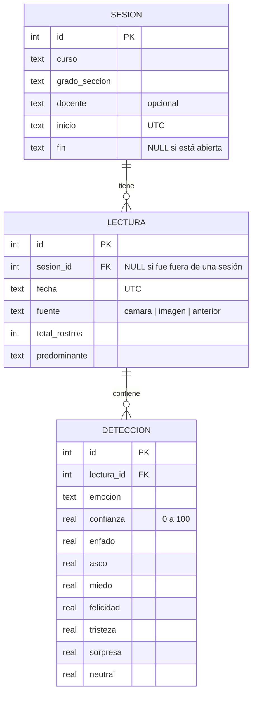

==================================================
PLAN: EMOTICONTIGO
==================================================

# EmotiContigo

## Equipo: Windows + R
- Ivan Ramiro Castillo Mamani  — Desarrollador Backend
- Ruth Estefani Huaman Mamani — Desarrollador Fullstack
- Eduardo Puma Ccorimanya — Desarrollador Frontend
- Rebeca Yasbet Rocca Ramos — Ingeniero ML / IA
- Avance: Implementación del modelo Face-Emotion-Detection para clasificación de expresiones.
- Junior Jeferson Sottec Velasque — QA / Testing
- Ayde Mirian Condori Valencia — QA / Testing

## Problema
Hoy en día en la sociedad muchas de las personas entre ellas niños presentan dificultades en lo que son sus aprendizajes, tienen dificultades para expresar sus emociones o encontrar orientación cuando atraviesan momentos complicados mostrando asi dificultades de aprendizaje. 

## Solucion
Desarrollaremos un sistema de inteligencia artificial que utilizara una camara para capturar imagenes de las expresiones faciales de los estudiantes durante las clases . Mediante un modelo de reconocimiento facial de expresiones , el sistema analizara las imagenes y clasificara expresiones como alegría, tristeza, sorpresa o neutralidad. Los resultados se mostraran en un interfaz con graficos y estadisticas para apoyar la observación del docente, sin asumir que las expresiones determinen si un niño aprendio o no.

## Alcance del Proyecto

EmotiContigo es una herramienta de **apoyo a la observación docente**. Su alcance está delimitado de forma explícita para garantizar un uso ético y responsable de la inteligencia artificial en el aula.

### Lo que el sistema SÍ hace

- Captura imágenes de expresiones faciales de los estudiantes durante la clase.
- Clasifica las expresiones en 7 emociones (enfadado, asco, miedo, felicidad, tristeza, sorpresa, neutral) con su porcentaje de confianza.
- Muestra gráficos y estadísticas al docente para apoyar su observación del aula.
- Guarda un historial de análisis (emoción y confianza) en SQLite, organizado por sesiones de clase, para consulta posterior.
- Actúa como **intermediario** entre el estudiante y el docente, facilitando la identificación de estados emocionales.

### Lo que el sistema NO hace (restricciones del alcance)

- **No se involucra en el desarrollo del estudiante.** No interviene en su proceso formativo ni emite juicios sobre su evolución personal.
- **No es parte del proceso ni del rendimiento académico.** No evalúa, califica ni condiciona la nota del estudiante.
- **No determina si un niño aprendió o no.** Las expresiones faciales no se interpretan como indicadores de aprendizaje.
- **No sustituye el criterio del docente.** El sistema solo presenta información; la interpretación y la acción pedagógica son responsabilidad del docente.
- **No almacena imágenes de los rostros.** El historial guarda únicamente la emoción detectada y el nivel de confianza, no la fotografía.

### Criterios de calidad del alcance

El alcance incluye criterios no funcionales verificables mediante pruebas automatizadas:

- **Cobertura de pruebas mínima:** 60% (`fail_under = 60` en `.coveragerc`).
- **Integración continua:** GitHub Actions ejecuta las pruebas en cada push a `main` y `develop`, y en pull requests a `main`.
- **Compatibilidad:** Python 3.10 y 3.11.
- **Calidad de código:** lint con `flake8` (max-line-length = 120).
- **Enfoque TDD:** el alcance ético se traduce en pruebas unitarias que protegen las restricciones anteriores.

### Trazabilidad del alcance

| Restricción del alcance | Prueba que la protege |
|---|---|
| No se involucra en el desarrollo del estudiante | `test_el_sistema_no_se_involucra_en_el_desarrollo_del_estudiante` |
| Solo es un intermediario entre estudiante y docente | `test_solo_ser_un_intermediario_entre_el_estudiante_y_el_docente` |
| No es parte del proceso ni rendimiento académico | `test_el_sistema_no_es_parte_del_proceso_o_rendimiento_academico_del_estudiante` |
| El sistema produce un resultado válido | `test_resultado_esperado` |
| No almacena imágenes de los rostros | `test_ninguna_tabla_guarda_imagenes` (en `tests/test_historial.py`) |

> **Nota:** estas pruebas se encuentran en `tests/` y se ejecutan con `python -m unittest discover -s tests -v`.

## Modelo de IA
- **Categoria:** image-classification
- **Modelo:** [Face-emotion-detection](https://huggingface.co/abhilash88/face-emotion-detection)
- **Input:** foto del rostro del niño de jpg o png
- **Output:** emocion detectado de las 7 clases con porcentaje
- **Justificacion:** Elegimos este modelo porque porque ya viene entrenado para reconocer rostros lo cual nos va ayudar a capturar las emociones de la población que elegimos en este caso los niños y tambien podemos reentrenarlo.

## Dataset
- **Nombre:** FER2013
- **Registros:** 35877
- **Columnas:** Imgen (pixels): Matriz de 48 *48 pixeles en escala de grises que capturan el rostro del alumno. Etiqueta(label): Valor entero del 0 al 6 que clasifica el estado emocional facial 0:enfadado 1: asco 2: miedo 3:Felicidad 4: tristeza 5: sorpresa 6 : Neutral

## Stack
- **Lenguaje:** python
- **Framework:** flask
- **ML:** Hugging Face Transformers
- **Testing:** unittest + TDD
- **Interfaz:** customtkinter + ttk, OpenCV para la cámara
- **Base de datos:** SQLite
- **Despliegue:** Docker y Docker Compose (gunicorn)
- **CI/CD:** GitHub Actions (pruebas, lint y construcción de la imagen Docker)

## Instalacion
```bash
git clone https://github.com/CastilloLAMI/Grupo_Windows_R.git
cd Grupo_Windows_R
python -m venv venv
venv\\Scripts\\activate
pip install -r requirements.txt
```

## Tests
```bash
python -m unittest discover -s tests -v
```

## Docker

El contenedor ejecuta la **API Flask con el modelo de IA** y una **página web de demostración** en `http://localhost:5000`, donde se sube una foto, se ve la emoción detectada y se consultan las estadísticas y el historial.

### Requisitos
- [Docker Desktop](https://www.docker.com/products/docker-desktop/) (Windows o Mac) o Docker Engine (Linux).
- La primera construcción descarga PyTorch y el modelo (unos 700 MB; la imagen ocupa alrededor de 2,4 GB en disco) y tarda varios minutos. Las siguientes reutilizan la caché.

### Con Docker Compose (recomendado)
```bash
docker compose up --build        # construye la imagen y levanta el servicio
# abrir http://localhost:5000
docker compose logs -f           # ver los registros
docker compose down              # detener (los datos se conservan en el volumen emoti-datos)
```

### Solo con Docker
```bash
docker build -t emoticontigo .
docker run -d --name emoticontigo -p 5000:5000 -v emoti-datos:/datos emoticontigo
docker ps                        # la columna STATUS debe decir (healthy)
```

### Qué hace el Dockerfile
| Paso | Por qué |
|---|---|
| `FROM python:3.11-slim` | Imagen base liviana con Python. |
| Copia `requirements-docker.txt` e instala dependencias **antes** del código | Docker reutiliza esa capa si solo cambia el código; reconstruir tarda segundos. |
| PyTorch **solo CPU** | La imagen pesa unos 2 GB menos que con CUDA; el aula no tiene GPU. |
| Usuario `emoti` (uid 1000), no root | Seguridad: el proceso no tiene privilegios de administrador. |
| Descarga el modelo al construir (`DESCARGAR_MODELO=1`) y activa `HF_HUB_OFFLINE` | El contenedor funciona **sin internet** durante la demostración. |
| `VOLUME /datos` con `EMOTI_BD=/datos/emoticontigo.db` | La base SQLite sobrevive a reinicios y reconstrucciones del contenedor. |
| `EMOTI_PRECARGAR=1` | El modelo se carga al arrancar: el primer análisis no espera. |
| `HEALTHCHECK` contra `/salud` | Docker sabe si la API responde (`healthy`). |
| `gunicorn` con 1 proceso y 4 hilos | Servidor de producción; el modelo se carga una sola vez en memoria. |

### Opciones
- **Modelo ajustado:** descomprime `modelo_emoticontigo.zip` en `modelos/` y descomenta `EMOTI_MODELO` en `docker-compose.yml`. La carpeta se monta en solo lectura.
- **Imagen más liviana:** `docker build --build-arg DESCARGAR_MODELO=0 -t emoticontigo .` (el modelo se descarga al primer uso; necesita internet).
- **Pruebas:** el job `docker` de GitHub Actions construye la imagen, levanta el contenedor, espera a que esté `healthy`, analiza una imagen y comprueba que los datos sobreviven a un reinicio.

### Por qué la app de escritorio no va en el contenedor
La interfaz Tkinter y la cámara necesitan la pantalla y la cámara USB de la PC. En Windows y Mac, Docker Desktop no puede pasar la cámara USB a un contenedor ni mostrar ventanas sin instalar un servidor gráfico aparte. Por eso el contenedor lleva la parte portable (API, modelo, base de datos y página web) y la app de escritorio se ejecuta en la PC del aula con `python -m src.interfaz`.

## API
- `GET /` → página web de demostración.
- `GET /salud` → estado del servicio.
- `POST /predecir` → recibe una imagen en el campo `imagen` (jpg/png, máximo 5 MB).
- `GET /estadisticas` → total de análisis, conteo por emoción y confianza promedio.
- `GET /historial?limite=50&sesion_id=3` → últimas detecciones (límite entre 1 y 100); `sesion_id` es opcional.
- `GET /sesiones` → sesiones de clase con su cantidad de lecturas y detecciones.
- `GET /estadisticas?sesion_id=3` → estadísticas de una sesión (sin `sesion_id`, de todas).

`POST /predecir` guarda el análisis en la sesión de clase abierta, si hay una.

## Base de datos

El historial se guarda en **SQLite**, en el archivo `emoticontigo.db` (la ruta se puede cambiar con la variable `EMOTI_BD`). El esquema está en [`db/esquema.sql`](db/esquema.sql) y hay consultas de ejemplo en [`db/consultas.sql`](db/consultas.sql). La aplicación crea las tablas al iniciar.



- **sesion:** una clase. Solo puede haber una abierta; si la app se cierra sin terminarla, se retoma al volver a abrirla.
- **lectura:** cada análisis, de un cuadro de la cámara o de una fotografía. Una lectura de la cámara sin rostros también se guarda (`total_rostros = 0`).
- **deteccion:** cada rostro de una lectura, con su emoción principal y el porcentaje de las 7 emociones.
- **Reglas en la base:** claves foráneas con borrado en cascada, `CHECK` para que la emoción sea una de las 7 del modelo, los porcentajes estén entre 0 y 100 y la fuente sea válida, e índices por sesión, fecha y emoción.
- **Privacidad:** no hay columnas para imágenes ni datos que identifiquen a un estudiante; cada detección es un rostro anónimo. Una prueba verifica que ninguna tabla tenga columnas como `imagen`, `foto` o `rostro`.
- **Migración:** si existe una base de la versión anterior (tabla `analisis`), sus registros pasan a una sesión «Historial anterior» y la tabla original se conserva como `analisis_v1`.

### ¿Por qué SQLite?

EmotiContigo es una aplicación de escritorio que usa un docente en la PC del aula:

- **Sin instalación ni servidor:** `sqlite3` viene incluido en Python y toda la base es un solo archivo.
- **Datos seguros:** las transacciones son ACID, así que no se pierden datos si se apaga la PC.
- **Privacidad:** los datos de los estudiantes no salen de la computadora del aula.
- **Pruebas y CI:** cada prueba crea una base temporal en un archivo; GitHub Actions no necesita levantar un servidor.
- **SQL completo:** permite un modelo relacional con claves foráneas, restricciones e índices.

Su límite es la concurrencia: un solo proceso escribe a la vez. Si el sistema creciera a varias aulas guardando en una base central, convendría migrar a PostgreSQL o MySQL; como todo el acceso a datos está en `src/historial.py`, ese cambio quedaría en un solo módulo.

## Interfaz de escritorio
```bash
python -m src.interfaz
```
Ventana hecha con customtkinter (y `ttk.Treeview` para la tabla del historial), con cuatro pestañas que siguen el mockup de `docs/mockup/`:

- **Clase en vivo:** primero se inicia una **sesión de clase** (curso, grado y sección, y docente opcional). Luego muestra la cámara con un recuadro y la emoción sobre cada rostro. Se elige la cámara y cada cuánto analizar (5, 10 o 30 s); *Capturar ahora* analiza al momento. A la derecha, el resumen del grupo: rostros detectados, emoción predominante, distribución promedio y últimas lecturas.
- **Analizar imagen:** analiza una fotografía (jpg o png); si hay una sesión abierta, se guarda en ella.
- **Estadísticas:** por sesión o de todas: expresiones registradas, lecturas, emoción más frecuente, confianza promedio y gráfico por emoción.
- **Historial:** tabla de las últimas 100 detecciones (con su sesión y fuente), filtros por sesión y por emoción, y exportación a CSV.

La cámara se lee y se analiza en segundo plano (`MonitorCamara` en `src/camara.py`), así la ventana no se congela mientras trabaja el modelo. Cada lectura se guarda en la sesión abierta, con una detección por rostro; las imágenes no se guardan.

La interfaz reutiliza `DetectorEmociones`. Para usar el modelo ajustado, define `EMOTI_MODELO` con la ruta de la carpeta que contiene `config.json` y `model.safetensors` (por ejemplo `modelos/modelo_emoticontigo`).

## Cámara del aula
```bash
python -m src.camara
```
Abre la cámara, detecta los rostros con el clasificador Haar de OpenCV y analiza cada rostro cada 5 segundos. Muestra un recuadro con la emoción sobre cada rostro (tecla `q` para salir) y guarda en el historial un registro por rostro. No se guardan las imágenes, solo la emoción y la confianza.

El módulo `src/camara.py` no depende de la interfaz: `Camara` abre y lee la cámara, `DetectorRostros` ubica los rostros, `AnalizadorAula` clasifica cada rostro y resume el grupo (emoción predominante y distribución promedio). Sus pruebas están en `tests/test_camara.py` y usan cámaras y rostros simulados.

## Constantes del proyecto

Los valores fijos (tamano maximo de imagen, extensiones permitidas, limites del historial y etiquetas de emociones FER2013) estan centralizados en `src/constantes.py` para evitar numeros magicos. Sus pruebas estan en `tests/test_constantes.py`.

---
*Proyecto Final — Construccion de Software — Universidad Continental*
