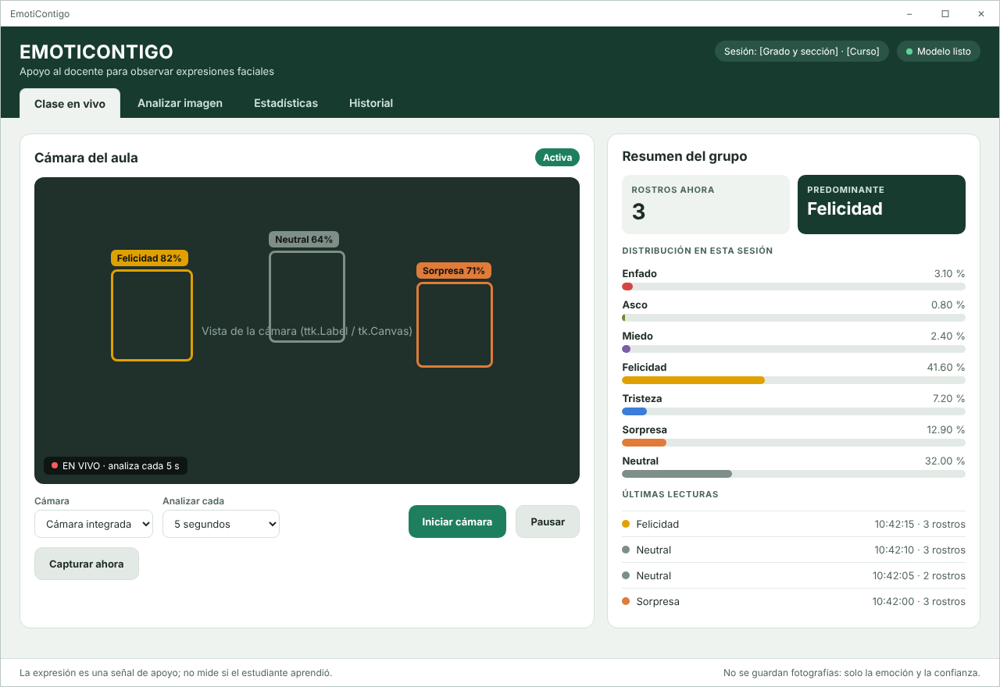
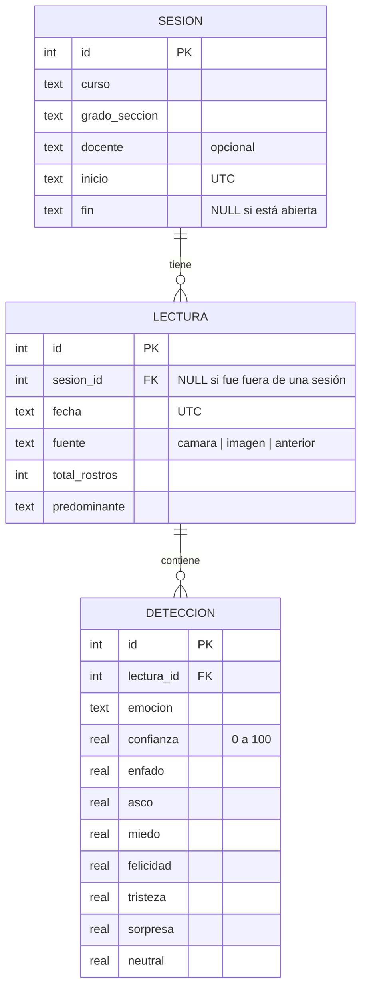

# EmotiContigo

Sistema que reconoce expresiones faciales de los estudiantes durante la clase y le muestra al docente un resumen del estado emocional del grupo. Es una herramienta de apoyo a la observación: no evalúa ni califica a nadie.

Proyecto final de Construcción de Software, Universidad Continental. Equipo **Windows + R**.



## Contenido

- [Problemática](#problemática)
- [Objetivo](#objetivo)
- [Público objetivo](#público-objetivo)
- [Tecnologías](#tecnologías)
- [Funcionalidades](#funcionalidades)
- [Modelo de inteligencia artificial](#modelo-de-inteligencia-artificial)
- [Ejecutar con Docker](#ejecutar-con-docker)
- [Instalación local](#instalación-local)
- [Pruebas y calidad](#pruebas-y-calidad)
- [API](#api)
- [Base de datos](#base-de-datos)
- [Alcance ético](#alcance-ético)
- [Estructura del repositorio](#estructura-del-repositorio)
- [Equipo](#equipo)

## Problemática

En un aula con 25 o 30 estudiantes, el docente no puede estar pendiente de cómo reacciona cada uno durante la clase. Muchos niños tienen problemas para expresar lo que sienten o no piden ayuda cuando algo no les queda claro o cuando pasan por un mal momento. Esas señales se pierden y el docente se entera tarde, o no llega a enterarse.

## Objetivo

Desarrollar una aplicación que capture con la cámara las expresiones faciales del grupo, las clasifique con un modelo de IA y presente al docente gráficos y estadísticas por sesión de clase, para que tenga un dato más al momento de observar a sus estudiantes.

## Público objetivo

- **Usuario directo:** docentes de educación básica que dictan clases presenciales.
- **Población observada:** los estudiantes del aula. El sistema no los identifica: cada rostro se registra como una detección anónima.

## Tecnologías

| Área | Herramienta |
|---|---|
| Lenguaje | Python 3.10 / 3.11 |
| Interfaz de escritorio | customtkinter, ttk (tabla del historial), matplotlib (gráficos) |
| Cámara y rostros | OpenCV (clasificador Haar) |
| Modelo de IA | Hugging Face Transformers + PyTorch |
| API y página web | Flask, gunicorn |
| Base de datos | SQLite |
| Pruebas | unittest (TDD), coverage, flake8 |
| Despliegue | Docker y Docker Compose |
| CI/CD | GitHub Actions |

## Funcionalidades

La aplicación de escritorio (`python -m src.interfaz`) tiene cuatro pestañas:

| Pestaña | Qué hace |
|---|---|
| Clase en vivo | Se abre una sesión de clase (curso, grado y sección, docente opcional). La cámara analiza el aula cada 5, 10 o 30 segundos, dibuja un recuadro con la emoción sobre cada rostro y muestra el resumen del grupo: rostros detectados, emoción predominante, distribución promedio y últimas lecturas. El botón *Capturar ahora* analiza en el momento. |
| Analizar imagen | Analiza una fotografía jpg o png. Si hay una sesión abierta, el resultado se guarda en ella. |
| Estadísticas | Por sesión o de todas: total de expresiones, lecturas, emoción más frecuente, confianza promedio y gráfico por emoción. |
| Historial | Las últimas 100 detecciones con filtros por sesión y emoción. Se puede exportar a CSV. |

La cámara se lee y se analiza en un hilo aparte (`MonitorCamara` en `src/camara.py`), así la ventana no se congela mientras el modelo trabaja.

**Validaciones y manejo de errores**

- Solo se aceptan imágenes jpg o png de hasta 5 MB. Un archivo corrupto o con otra extensión devuelve un error claro y no detiene la aplicación.
- El límite del historial debe estar entre 1 y 100, y `sesion_id` debe ser un entero que exista (error 400 o 404 según el caso).
- Solo puede haber una sesión abierta. Si la aplicación se cierra sin terminar la sesión, al volver a abrirla se retoma.
- Al arrancar, la API revisa que ninguna ruta viole el alcance ético del sistema. Si alguna lo hace, no inicia.

Los mockups de las cuatro pantallas están en [`docs/mockup/`](docs/mockup/).

## Modelo de inteligencia artificial

### Qué modelo usamos

[`abhilash88/face-emotion-detection`](https://huggingface.co/abhilash88/face-emotion-detection), un Vision Transformer (ViT-Base) entrenado con FER2013 para clasificar imágenes (`image-classification`).

### Por qué lo elegimos

- Ya viene entrenado para reconocer expresiones faciales, así que no partimos de cero con un dataset de solo 35 mil imágenes.
- Reconoce las 7 emociones de FER2013, que es el estándar en este tipo de problemas.
- Se usa con pocas líneas a través de `pipeline` de Transformers y funciona en CPU, que es lo que hay en una PC de aula.
- Se puede reentrenar. Lo hicimos (ver abajo) y mejoró en las 7 clases.

### Entrada y salida

- **Entrada:** la imagen del rostro (jpg o png, o el recorte de un cuadro de la cámara), convertida a RGB.
- **Salida:** la emoción principal, su porcentaje de confianza y el porcentaje de cada una de las 7 emociones.

```json
{
  "emocion": "felicidad",
  "confianza": 91.37,
  "todas": {"felicidad": 91.37, "neutral": 4.12, "sorpresa": 2.05, "tristeza": 1.10,
            "enfado": 0.71, "miedo": 0.48, "asco": 0.17}
}
```

### Flujo dentro del sistema

1. OpenCV toma un cuadro de la cámara y el clasificador Haar ubica los rostros.
2. Cada rostro se recorta y pasa por `DetectorEmociones.predecir()` (`src/model.py`).
3. `AnalizadorAula` junta los resultados de todos los rostros y calcula la emoción predominante y la distribución del grupo.
4. Se guarda la lectura en SQLite (solo emociones y porcentajes, nunca la imagen) y se actualiza la interfaz.

### Dataset y ajuste fino

- **Dataset:** FER2013, 35 887 imágenes de 48×48 píxeles en escala de grises, 7 clases (0 enfado, 1 asco, 2 miedo, 3 felicidad, 4 tristeza, 5 sorpresa, 6 neutral).
- **Partición original:** 28 709 de entrenamiento, 3 589 de validación y 3 589 de prueba.
- **Ajuste:** 3 épocas, tasa de aprendizaje 2e-5, lote 64, pesos por clase para compensar el desbalance y aumentos de datos. Notebook en [`notebooks/entrenamiento_emociones.ipynb`](notebooks/entrenamiento_emociones.ipynb) (Google Colab, GPU T4).

| Métrica (3 589 imágenes de prueba) | Modelo original | Modelo ajustado |
|---|---|---|
| Exactitud | 71.7 % | 73.0 % |
| F1 macro | 0.700 | 0.718 |

El detalle por emoción y las matrices de confusión están en [`docs/entrenamiento/`](docs/entrenamiento/). El modelo ajustado pesa unos 330 MB y no se sube a GitHub; para usarlo, se define `EMOTI_MODELO` con la carpeta del modelo.

### Limitaciones

- **Entrenado con adultos.** FER2013 tiene sobre todo rostros de adultos, y nuestro público son niños. Lo más probable es que la precisión real en un aula sea menor que el 73 % medido.
- **No todas las emociones se reconocen igual de bien.** Felicidad (F1 0.92) y sorpresa (0.82) salen bien; miedo (0.58) y tristeza (0.59) fallan bastante más.
- **Se confunde entre expresiones parecidas:** tristeza con neutral, asco con enfado, miedo con tristeza. A una persona también le cuesta distinguirlas.
- **Poca data de asco:** solo 55 imágenes en la parte de prueba, así que esa métrica es poco confiable.
- **Depende de la cámara y la luz.** El clasificador Haar solo detecta rostros de frente; con poca luz, perfiles, mascarillas o estudiantes lejos de la cámara, se pierden rostros.
- **Una expresión no es una emoción.** Un niño puede estar serio y no estar triste. Por eso el resultado se presenta como apoyo al docente y nunca como diagnóstico o evaluación.
- **El endpoint `/predecir` analiza la imagen completa.** No recorta el rostro como sí lo hace la cámara, así que funciona mejor con fotos donde la cara ocupa casi todo el cuadro.

## Ejecutar con Docker

El contenedor lleva la API Flask con el modelo, OpenCV, la base de datos y una **página web con las mismas cuatro pestañas** que la app de escritorio, en `http://localhost:5000`: *Clase en vivo* (con la cámara), *Analizar imagen*, *Estadísticas* e *Historial*. Así todo el sistema se puede usar desde el contenedor.

**Requisitos:** [Docker Desktop](https://www.docker.com/products/docker-desktop/) en Windows o Mac (en Windows necesita WSL 2) o Docker Engine en Linux. La primera construcción descarga PyTorch y el modelo (unos 700 MB) y tarda varios minutos; la imagen ocupa alrededor de 2,4 GB. Las siguientes construcciones usan la caché y tardan segundos.

### Con Docker Compose (recomendado)

```bash
docker compose up --build    # construye la imagen y levanta el servicio
# abrir http://localhost:5000
docker compose logs -f       # ver los registros
docker compose down          # detener (los datos se quedan en el volumen emoti-datos)
```

### Solo con Docker

```bash
docker build -t emoticontigo .
docker run -d --name emoticontigo -p 5000:5000 -v emoti-datos:/datos emoticontigo
docker ps                    # en STATUS debe aparecer (healthy)
```

### Qué hace el Dockerfile

| Paso | Por qué |
|---|---|
| `FROM python:3.11-slim` | Imagen base liviana con Python. |
| Copia `requirements-docker.txt` e instala dependencias antes de copiar el código | Docker reutiliza esa capa si solo cambia el código, así que reconstruir tarda segundos. |
| PyTorch solo para CPU | La imagen pesa unos 2 GB menos que con CUDA, y una PC de aula no tiene GPU. |
| Usuario `emoti` (uid 1000) en vez de root | El proceso corre sin privilegios de administrador. |
| Descarga el modelo al construir (`DESCARGAR_MODELO=1`) y activa `HF_HUB_OFFLINE` | El contenedor funciona sin internet. |
| `VOLUME /datos` con `EMOTI_BD=/datos/emoticontigo.db` | La base SQLite sobrevive a reinicios y reconstrucciones. |
| `EMOTI_PRECARGAR=1` | El modelo se carga al arrancar y el primer análisis no tiene que esperar. |
| `HEALTHCHECK` contra `/salud` | Docker sabe si la API responde. |
| `gunicorn` con 1 proceso y 4 hilos | Servidor de producción; el modelo se carga una sola vez en memoria. |
| `opencv-python-headless` | OpenCV sin interfaz gráfica: detecta los rostros de la cámara dentro del contenedor sin necesitar pantalla. |

**Opciones**

- Modelo ajustado: descomprimir `modelo_emoticontigo.zip` en `modelos/` y descomentar `EMOTI_MODELO` en `docker-compose.yml`. La carpeta se monta en solo lectura.
- Imagen más liviana: `docker build --build-arg DESCARGAR_MODELO=0 -t emoticontigo .` (el modelo se descarga al primer uso y necesita internet).

### La cámara desde el contenedor

En Windows y Mac, Docker Desktop no puede pasar una cámara USB al contenedor ni mostrar ventanas de escritorio. Por eso la cámara la abre el **navegador**: la pestaña *Clase en vivo* toma un cuadro cada 5, 10 o 30 segundos (o al pulsar *Capturar ahora*) y lo envía a `POST /analizar-cuadro`. Dentro del contenedor, OpenCV ubica los rostros, el modelo clasifica cada uno y la respuesta vuelve con los recuadros, que la página dibuja sobre el video. El cuadro no se guarda: solo la lectura y sus detecciones, en la sesión abierta.

- El navegador pide permiso para usar la cámara la primera vez.
- Solo funciona en `http://localhost:5000` o con HTTPS: es una regla de seguridad de los navegadores.
- Para empezar a usar la cámara hay que iniciar una sesión de clase (si no, la API responde `409`).

La app de escritorio (`python -m src.interfaz`) sigue disponible para usar el sistema sin Docker.

## Instalación local

Requiere Python 3.10 o 3.11 y Git.

```bash
git clone https://github.com/CastilloLAMI/Grupo_Windows_R.git
cd Grupo_Windows_R
python -m venv venv
```

Activar el entorno virtual:

```bash
# Windows (PowerShell o CMD)
venv\Scripts\activate

# Linux / macOS
source venv/bin/activate
```

Instalar dependencias y ejecutar:

```bash
pip install -r requirements.txt

python -m src.interfaz   # aplicación de escritorio
python -m src.app        # solo la API, en http://localhost:5000
python -m src.camara     # cámara en ventana simple (tecla q para salir)
```

La primera vez que se usa el modelo, se descarga de Hugging Face (necesita internet).

> En Windows, si PowerShell no deja activar el entorno, ejecutar una vez `Set-ExecutionPolicy -Scope CurrentUser RemoteSigned`. Conviene clonar el proyecto fuera de OneDrive, porque sincronizar el `venv` vuelve lenta la PC.

**Variables de entorno**

| Variable | Para qué | Valor por defecto |
|---|---|---|
| `EMOTI_BD` | Ruta del archivo SQLite | `emoticontigo.db` |
| `EMOTI_MODELO` | Carpeta del modelo ajustado (con `config.json` y `model.safetensors`) | modelo de Hugging Face |
| `EMOTI_PRECARGAR` | `1` carga el modelo al iniciar la API | sin precarga |

## Pruebas y calidad

```bash
python -m unittest discover -s tests -v             # pruebas
python -m coverage run -m unittest discover -s tests
python -m coverage report                           # cobertura (mínimo 60 %)
flake8 src tests --max-line-length=120              # estilo
```

- Más de 150 pruebas unitarias y de integración; la cámara, los rostros y el modelo se simulan para que corran sin hardware ni internet.
- GitHub Actions corre lint y pruebas con Python 3.10 y 3.11 en cada push y pull request a `main` y `develop`. También construye la imagen Docker, levanta el contenedor, espera a que esté `healthy`, analiza una imagen y comprueba que los datos sigan ahí después de reiniciarlo.

## API

| Método y ruta | Descripción |
|---|---|
| `GET /` | Página web de demostración |
| `GET /salud` | Estado del servicio |
| `POST /predecir` | Recibe una imagen en el campo `imagen` (jpg/png, máximo 5 MB) y devuelve la emoción. Si hay una sesión abierta, la guarda en ella. |
| `GET /estadisticas?sesion_id=3` | Total de análisis, conteo por emoción y confianza promedio. Sin `sesion_id`, de todas las sesiones. |
| `GET /historial?limite=50&sesion_id=3` | Últimas detecciones (límite entre 1 y 100; `sesion_id` opcional) |
| `GET /sesiones` | Sesiones de clase con su cantidad de lecturas y detecciones |
| `POST /sesiones` | Abre una sesión de clase. JSON: `curso`, `grado_seccion` y `docente` (opcional). Cierra la que estuviera abierta. |
| `POST /sesiones/<id>/cerrar` | Cierra la sesión (`404` si no existe, `409` si ya estaba cerrada) |
| `POST /analizar-cuadro` | Recibe un cuadro de la cámara en el campo `imagen`, detecta y clasifica todos los rostros y devuelve sus recuadros, la emoción predominante y la distribución del grupo. Necesita una sesión abierta (`409` si no hay). |

Ejemplo:

```bash
curl -F "imagen=@rostro.jpg" http://localhost:5000/predecir
```

## Base de datos

El historial se guarda en SQLite, en `emoticontigo.db` (se cambia con `EMOTI_BD`). El esquema está en [`db/esquema.sql`](db/esquema.sql) y hay consultas de ejemplo en [`db/consultas.sql`](db/consultas.sql). La aplicación crea las tablas al iniciar.



- **sesion:** una clase. Solo puede haber una abierta.
- **lectura:** cada análisis, de un cuadro de la cámara o de una foto. Una lectura sin rostros también se guarda (`total_rostros = 0`).
- **deteccion:** cada rostro de una lectura, con su emoción principal y el porcentaje de las 7 emociones.
- **Reglas:** claves foráneas con borrado en cascada; `CHECK` para que la emoción sea una de las 7, los porcentajes estén entre 0 y 100 y la fuente sea válida; índices por sesión, fecha y emoción.
- **Privacidad:** no hay columnas para imágenes ni para datos que identifiquen a un estudiante. Una prueba revisa que ninguna tabla tenga columnas como `imagen`, `foto` o `rostro`.
- **Migración:** si existe una base de la versión anterior (tabla `analisis`), sus registros pasan a una sesión «Historial anterior» y la tabla original se conserva como `analisis_v1`.

**¿Por qué SQLite?** Es una app que usa un docente en la PC del aula. SQLite viene con Python, toda la base es un solo archivo, las transacciones no pierden datos si se apaga la PC y la información de los estudiantes no sale de esa computadora. Su límite es que solo un proceso escribe a la vez. Si el sistema creciera a varias aulas con una base central, habría que pasar a PostgreSQL o MySQL; como todo el acceso a datos está en `src/historial.py`, el cambio quedaría en un solo módulo.

## Alcance ético

EmotiContigo apoya la observación del docente y no va más allá de eso. El alcance está escrito en `src/alcance.py` y protegido con pruebas.

**Lo que sí hace**

- Captura y clasifica las expresiones faciales del grupo en 7 emociones con su porcentaje de confianza.
- Muestra gráficos y estadísticas por sesión de clase.
- Guarda un historial de emociones y porcentajes, sin imágenes.

**Lo que no hace**

- No evalúa, califica ni influye en la nota del estudiante.
- No determina si un niño aprendió o no.
- No interviene en el desarrollo del estudiante ni emite juicios sobre él.
- No reemplaza el criterio del docente: el sistema muestra información y el docente decide qué hacer con ella.
- No guarda fotos de los rostros.

| Restricción | Prueba que la protege |
|---|---|
| No se involucra en el desarrollo del estudiante | `test_el_sistema_no_se_involucra_en_el_desarrollo_del_estudiante` |
| Solo es un intermediario entre estudiante y docente | `test_solo_ser_un_intermediario_entre_el_estudiante_y_el_docente` |
| No es parte del proceso ni del rendimiento académico | `test_el_sistema_no_es_parte_del_proceso_o_rendimiento_academico_del_estudiante` |
| El sistema produce un resultado válido | `test_resultado_esperado` |
| No almacena imágenes de los rostros | `test_ninguna_tabla_guarda_imagenes` (en `tests/test_historial.py`) |

## Estructura del repositorio

```
Grupo_Windows_R/
├── src/
│   ├── interfaz.py        # app de escritorio (4 pestañas)
│   ├── camara.py          # cámara, detección de rostros y análisis del aula
│   ├── model.py           # DetectorEmociones (modelo de Hugging Face)
│   ├── app.py             # API Flask
│   ├── historial.py       # acceso a SQLite
│   ├── alcance.py         # reglas del alcance ético
│   ├── preprocess.py      # validación y etiquetas
│   ├── constantes.py      # límites y valores fijos
│   └── web/index.html     # página web con las 4 pestañas (Docker)
├── tests/                 # pruebas unitarias y de integración
├── db/                    # esquema y consultas SQL
├── notebooks/             # ajuste fino del modelo (Colab)
├── docs/
│   ├── mockup/            # diseño de las pantallas
│   └── entrenamiento/     # métricas y matrices de confusión
├── Dockerfile
├── docker-compose.yml
├── requirements.txt         # dependencias completas (app de escritorio y desarrollo)
├── requirements-docker.txt  # dependencias de la imagen Docker
└── .github/workflows/ci.yml
```

## Equipo

| Integrante | Rol |
|---|---|
| Ivan Ramiro Castillo Mamani | Backend |
| Ruth Estefani Huaman Mamani | Fullstack |
| Eduardo Puma Ccorimanya | Frontend |
| Rebeca Yasbet Rocca Ramos | ML / IA |
| Junior Jeferson Sottec Velasque | QA / Testing |
| Ayde Mirian Condori Valencia | QA / Testing |

Trabajamos con GitFlow: cada funcionalidad se desarrolla en su rama `feature/...` y entra a `main` mediante pull request.
